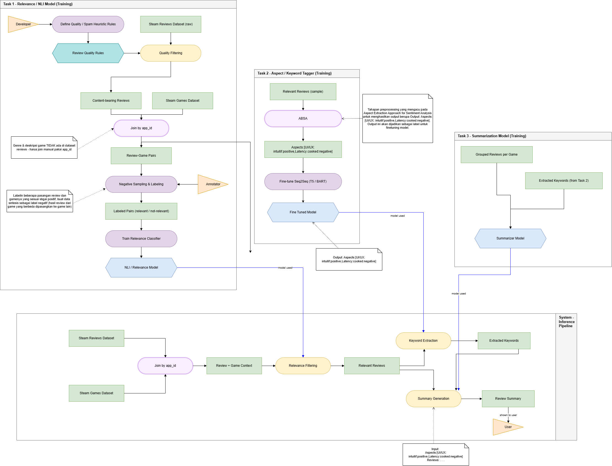

# IF5153_NLP_Final_Projects



## About

Group 5 of IF5153 NLP lecture presents A Steam Reviews Summary Generation. This contains three main NLP pipeline from finding relevance filtering with NLI and get the relevance score and finding relevant category, extracting aspects with Aspect-Based Sentiment Analysis to find the aspects based on the gameplay, aspect, and sentiment, and summarizing some of the reviews with generation model into one paragraph with the help of the reviews and the aspects.

## Expected Dataset

Original: Steam Reviews from

```
{
  "1": {"app_id": 292030, "reviews": ["review 1", "review 2", "..."]},
  "2": {"app_id": 1086940, "reviews": ["..."]}, ...
}
```

(Phase 1 → Phase 2: `data/output/relevant_reviews.csv` (batch) or `POST /phase1/filter` (API, served via ngrok).):

```
{
    "1": {"review_id": ..., "app_id":, "app_name": ..., "review_text": ..., "relevance_score": ..., "is_relevant": ..., "score_band: ..., "rejected_by": ..., "model_run": ... },
    "2": {"review_id": ..., "app_id":, "app_name": ..., "review_text": ..., "relevance_score": ..., "is_relevant": ..., "score_band: ..., "rejected_by": ..., "model_run": ... },
    ...
}
```

(Phase 2 → Phase 3: `data/phase2/modeled/keyword_predicted.jsonl` (batch) or `POST /inference` (API, served via ngrok).):

```
{
    "1": {"review_id": ...,  "app_name": ..., "review_text": [..., ..., ...], "aspects": [{category:aspect:sentiment}, ..., ...],
    "raw_predictions": ["aspect: [...]]},
    "2": {"review_id": ...,  "app_name": ..., "review_text": [..., ..., ...], "aspects": [{category:aspect:sentiment}, ..., ...],
    "raw_predictions": ["aspect: [...]]},
    ...
}
```

## Environment Setting

Make sure you have uv environment being installed on your device. For uv installation, please open the uv documentation (https://docs.astral.sh/uv/):

1. Install all the dependencies

```
uv sync
```

2. Direct to cli.py file

```
cd src/
```

3. Run the cli file directly with preinstalled python extentions from IDE or run the uv

```
uv run python cli.py
```

### Expected Results

1. Task 1: Have set of semi-structured data that being classified based on "review_id", "app_id", "app_name", "review_text", "relevance_score", "is_relevant", "score_band", "model_run" which have being scored on "relevance_score" from 0-0.4 is being off topic, 0.4-0.7 is being borderline, and 0.7 above is being relevant

| index | review_id | app_id | app_name       | ... | score_band | rejected_by | model_run    |
| ----- | --------- | ------ | -------------- | --- | ---------- | ----------- | ------------ |
| 0     | 3832200   | 302380 | Floating Point | ... | borderline | NaN         | task_adapted |
| 1     | 2124809   | 238320 | Outlast        | ... | borderline | NaN         | task_adapted |

2. Task 2: Have set of semi-structured data that being classified based on "app_name", "review_text", "aspects", "raw_prediction"

```
"1": {
    "app_name": "Redemption: Eternal Quest",
    "reviews": [..., ...],
    "aspects": {category:aspect:sentiment}, ...,
    "raw_prediction": [aspects: {category:aspect:sentiment}, ...]
},
"2" : {
    "app_name": "Californium",
    "reviews": [..., ...],
    "aspects": {category:aspect:sentiment}, ...,
    "raw_prediction": [aspects: {category:aspect:sentiment}, ...]
}
```

3. Task 3: Have one final summary generation based on the aspects and reviews

```
{
"app_name" : Terraria
Kept Reviews (8):
  1. 10/10 would dig a hole again.
  2. Building NPC pylons across every biome makes fast travel a breeze once you figure out who likes living next to whom.
  3. I only bought this because my friend told me it was 2D Minecraft and now I have 900 hours, send help.
  ...
}

{
"expected_aspects" :
  1. Aspects: [Gameplay:multiplayer:neutral]
  2. Aspects: [Gameplay:pylons:positive]
  3. Aspects: [Gameplay:multiplayer:positive]
}

{
  "msg": "Terraria is a 2D sandbox game that offers a positive multiplayer experience with NPC pylons and fast travel, but its price is negative and the Lava Charm RNG makes crafting the Terraspark Boots take forever. The game's progression from wooden armor and a copper shortsword to fighting Moon Lord with Zenith is unmatched in sandbox games."
}
```

## Task Assignments

| Phase | Task                                                  | Code                                                                      | Branch        | PIC      |
| ----- | ----------------------------------------------------- | ------------------------------------------------------------------------- | ------------- | -------- |
| 1     | Review relevance filtering (cross-encoder, NLI-style) | `src/phase1/` ([README](src/phase1/README.md), [API](docs/phase1_api.md)) | `feat/phase1` | 13523104 |
| 2     | Aspect extraction (ABSA, T5/BART)                     | `src/phase2/`                                                             | `feat/phase2` | 18223140 |
| 3     | Summary generation + demo CLI                         | `src/`                                                                    | `feat/phase3` | 18223115 |
